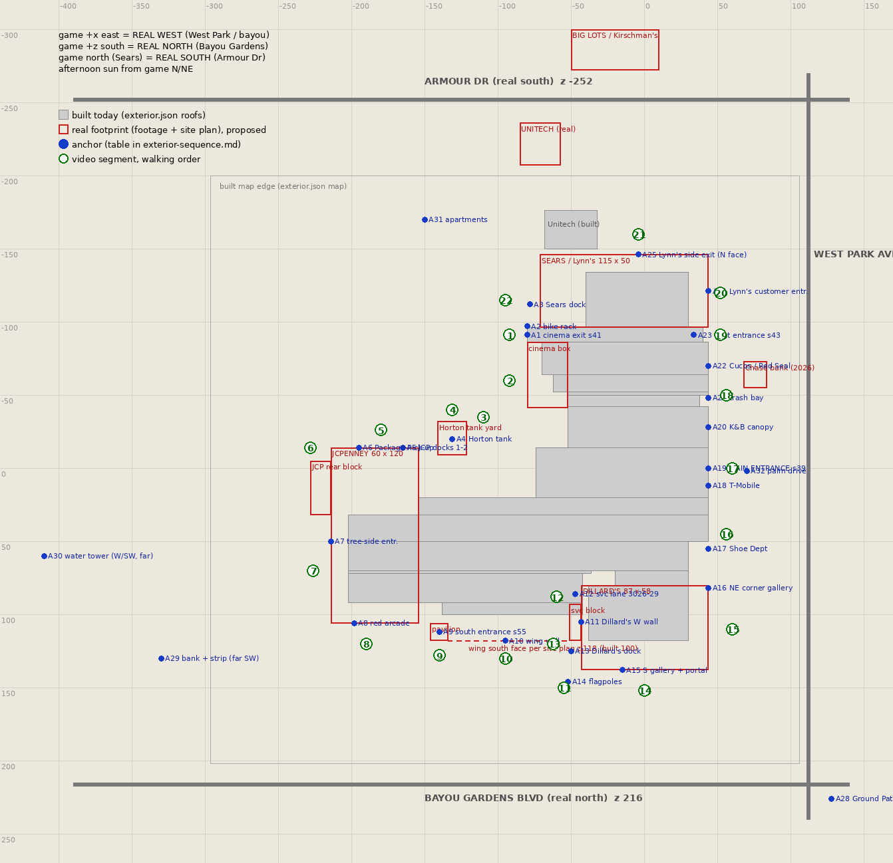

# The outside of the mall, in walking order — Workstream EXT, Nov 3 2026

Analysis only (no geometry, no textures changed). What the Oct 23 2026 site-visit videos show of the
outside, cut and put back in walking order round the building, and compared with what wing 3 builds
today (`prototypes/godot-mall/project/exterior.json`, `tools/exterior/wall_fixes.py`,
`design/godot-exterior.md`). Steven's brief: the Dillard's side to the front entrance is good and the
inside is good; it goes wrong behind Sears / Lynn's, and the outside doesn't match the mall.

Sources: the refs pack (branch `refs`): every exterior video and transcript (IMG_4406, 4413, 4416,
4426, 4486–4490, 4492, 4493; photos 4417, 4418), the analysis notes A, C, D, E, the 2026 directory
map (`refs/derived/photos/IMG_4455.jpg`) and the Morguard site plan
(`design/exterior/morguard-site-plan-2024.png`). Diagram: `design/exterior/exterior-sequence-plan.png`.
Renders of the build: `production/qa/evidence/wsEXT-*.jpg` (unbaked, see "Evidence").

Frame numbers: `refs/derived/frames/IMG_xxxx/fNNN.jpg`, fNNN ≈ (NNN−1)×2 s. Coordinates are the
game's (metres, +x east, +z south, as `layout_mall.json`).

## 1. Short version

- **The videos are in shooting order, not walking order.** The outside was filmed in four pieces:
  the east facade north half first (4406), the cinema exit early (4416), then one long walk from the
  cinema exit round the back, JCPenney and the Bayou Gardens side to Dillard's (4486 → 4487 → 4488 →
  4489 → 4490, continuous), and at the end the east facade from the main entrance both ways (4492
  south, 4493 north). Joined, they cover the whole perimeter except two gaps: Sears / Lynn's north
  face (Armour Dr side, only the side-exit view 4413) and Dillard's east face south of its NE corner.
- **The compass is turned 180°.** Three independent readings agree (§2): the game's north (Sears,
  Armour Dr) is real south; the game's east (main entrance, West Park Ave, the bayou) is real west.
  The footage was shot in the early afternoon, so the sunlit faces are the game-north and game-east
  ones. Not a build problem by itself, but the day bake's sun should come from the game's N/NE.
- **What is wrong behind Sears:** the Sears / Lynn's box is far too small and sits 30–40 m too far
  east, so the cinema exit stands alone with a 40 m gap north of it. In reality Sears's west wall is
  only ~10 m east of the exit's face, the loading dock is right there (Steven's anchor), the box runs
  115 m east to the facade line and 50 m deep, and the cinema box runs 45 m south of the exit as a
  straight wall. The staff lot, the tank and JCPenney's north face are then all ~40–50 m further
  north than built, the lot behind Sears is 100 m deep to Armour Dr, Unitech sits by that road, and
  Big Lots (Kirschman's in 1995) is across **Armour Drive north of Sears**, not across West Park Ave.
- The mismatch list with numbers is §5; the questions for Steven are §7.

## 2. Orientation and time of day

| Evidence | What it says |
|---|---|
| Dillard's in-store directory (4490 f074/f076): NORTH ENTRANCE at top, WEST ENTRANCE left, SOUTH MALL ENTRANCE bottom | Steven entered Dillard's "from the Bayou Gardens side" (4490 112 s) through the gallery portal = Dillard's "North entrance". So the game's south (Bayou Gardens) is real north; the mall side of Dillard's (game north) is real south; the West Park side (game east) is real west. |
| Morguard site plan north arrow | Points to the page's lower left, i.e. away from Armour Dr and toward Bayou Gardens: Bayou Gardens is the north edge of the site, Armour Dr the south, West Park Ave the west. Same answer. |
| The sun | 4406 f033–035 (first video, looking north along the east facade): the sun is in frame, high, ~15° east of the facade line. 4486 f069–072 (later): lens flare looking toward the cinema (game NE). 4486 f025–035: Steven walks south along the cinema's west wall and his shadow falls ahead of him, ~1.6× his height. 4489 f002–015: JCPenney's game-south face and the pavilion are in shade; 4487 f007–010: JCPenney's game-north face is in full sun. All of it: sun in the game's N to NE, 30–45° up. On Oct 23 at Houma that is the real S to SW, between about 1 pm and 3:30 pm. |

Confidence: high on the 180° turn (three sources). The visit order 4406 → … → 4493 is the iPhone's
numbering, so it is the shooting order for certain.

Practical consequences: West Park Ave and the bayou are on the real west; Bayou Gardens Blvd is the
real north side; Armour Drive the real south; the soccer fields and the back lot the real east.
Nothing in the layout needs mirroring (Steven's "Sears to our right" walking in from the east
entrance, 4406 56 s, is the game's layout), only the sun and anything that quotes a compass direction.

## 3. The loop, in walking order

Start at the Southland Cinema exit (s41) facing the doors from the lot. Steven's anchors as filmed:
the 3-loop bike rack stands against the white-painted brick wall just left (north) of the glass,
its loops running along the wall, i.e. parallel to the doors (4416 f009–011, 4486 f002–003); left of
that wall, across a depressed truck well with a yellow pipe rail, is the Sears loading dock under a
flat white canopy on pipe columns (4486 f006–010). Right of the glass is the buff-brick return with
the old poster case (4417), then the tall salmon-brick cinema box (4416 f004–007).

"Right" from the doors is south along the west side; "left" is north to the dock. The table goes
right first and comes back round to the dock. Confidence is for the link to the **next** row.

| # | Video, time (frames) | What it shows | Where on the building | Link |
|---|---|---|---|---|
| 1 | 4416 0–22 s (f001–011); 4486 0–6 s (f001–003); photos 4417, 4418; inside: 4414 30–38 s, 4485 56–70 s | The cinema-wing exit: brown aggregate fascia, 2-tier glass, 2 door pairs, white brick north return with the bike rack, buff return with the poster case | West face, door at x −80, z −96..−86 | certain (4486 runs on) |
| 2 | 4486 24–74 s (f013–037) | The cinema's west wall: salmon brick ~9 m, peach pilasters and base, hooded exit doors, FDC, the ramp with the peach knee wall and rail, pink fire lane | West face, x ≈ −80, z −86 → −41 (built: −70, −86 → −64) | certain |
| 3 | 4486 74–150 s (f038–076) | The staff lot and the pan: the tan-brick backs of the H5 north row with the dark soldier course, the taller red Woolworth block with the compactor and TRASH ONLY dumpster (f047–051), Dillard's third floor over the roofs (f074–076), the apartments (f067–068) | Lot centre ≈ (−110, −30); the backs at z ≈ 20–27 and x −74..−52 | certain |
| 4 | 4486 106–204 s (f053–102) | The 1970 Horton tank in its chain-link yard, the peach utility building, the conduit pole, the water tower behind | Real: x −141..−121, z −32..−9 (built: −124..−96, −18..14) | certain |
| 5 | 4486 204–232 s (f103–116); 4487 0–20 s (f001–010) | JCPenney's north face: white brick, red "JCPenney", docks 1–2 under the red canopy, compactor, then the Package Pick-up recess with the coral ribbed fascia | North face at z ≈ −14 (built 32), x −154 → −214 | certain (Steven: "standing at the entrance … where the package [pickup] is") |
| 6 | 4487 20–108 s (f011–054) | NW corner, pine island with hydrant, the tall blank rear block, the back (west) lot pan: soccer fields, apartments, water tower, St Bernadette, the drive-thru bank and the strip centre far to the SW | NW corner (−214, −14); rear block to x −228 | certain |
| 7 | 4488 0–52 s | JCPenney's west face: roll-up receiving door on the tall block, the "tree-side" entrance under the maroon fascia, the wordmark wall with the podocarpus | West face x −214, z 32 → 106 | high |
| 8 | 4489 0–60 s (f001–030) | SW corner, the south face: the red arcade entrance, dead hedge, second wordmark; Bayou Gardens with its palms across the lot | South face z ≈ 106 (built 92), x −214 → −154 | high (Steven opens "facing Bayou Gardens") |
| 9 | 4489 60–116 s (f031–058) | The south entrance pavilion (Corn Dog 7 door, s55): set-back EIFS link, banded pilasters, thin white cornice slab, loggia, bike rack on JCPenney's brick, tactile strip, drop-off bulb, live oak island | Inside corner JCPenney / wing, x ≈ −146..−134, front at z ≈ 118 (built: door 88, front ~99) | certain |
| 10 | 4489 116–138 s (f059–069) | The low two-tone wing wall, no doors, diamond wall-packs, photinia blocks | South face of the wing, z ≈ 118 per the plan (built 100), x −134 → −51 | certain |
| 11 | 4489 138–166 s (f070–083); 4490 0–10 s (f001–005) | Dillard's west end wall with the wordmark, white base, FDC; the pink lane turns south along it; Ground Pat'i cube sign and an old bare pole seen far off to the SE | Dillard's west face x ≈ −43 (built −38) | certain (4490 opens "continuing … between JCPenney to Dillard's") |
| 12 | 4490 10–24 s (f006–012) | The service lane: three-band painted brick, doors 3026 Marketing, 3027 Bath & Body Works, 3029 on stoops, CMU screen wall, dead end with a canopy | The notch between the H5 south row and Dillard's, ≈ (−47, 85..95); built as the alley x −42..−20, z 70..80 | certain |
| 13 | 4490 24–56 s (f013–028) | Dillard's west face south part, the alley to the lower service block (wood fence, manholes), the covered loading dock with a trailer, roll-off, the white base with doors | West side, x −51..−43, z 95 → 138 | certain |
| 14 | 4490 56–112 s (f029–056) | SW corner: flagpole island, then the cast-iron lace gallery on bronze columns with the sunburst-fanlight blind doors, pebble paving, bollard lights, the "Dillard's" portal and 4 door pairs, in | **South face**, z ≈ 138 (built 118), portal at x ≈ −15 | certain |
| 15 | not filmed | Dillard's SE corner and east face; the gallery is seen wrapping the NE corner in 4492 f100–108 | East face x 44 (built 30), z 80 → 138 | gap |
| 16 | 4492 134–196 s (f067–099), walked the other way | T-Mobile (unit 1029, magenta letters, shed awning), the Shoe Dept white ACM front with three stainless canopies (1003A), the blank ACM wall, the yellow-hatched loading lane with the box truck, the Dillard's NE corner | East facade x 44, z 7 → 80 | medium (a different walk; joined by the gallery corner and the PHOTO / ACADIAN strip across West Park seen from both) |
| 17 | 4492 96–134 s (f049–066); 4426; photos 4427–4436 | The main entrance: the porte-cochère with the banded tile columns, the palm drive to West Park with the STOP bars and the ladder crosswalk, the signal | East face, (44, 0); drive to x ≈ 112 | certain |
| 18 | 4493 0–88 s (f001–044); 4406 0–60 s (f001–030) | North of the entrance: tan EIFS panels and white wainscot, Hypervelocity on K&B's folded-plate canopy (1043), the louvered trash / transformer bay, The Red Seal's stepped parapet, mural and awnings | East facade x 44, z −14 → −86 | certain (Steven: "back to the front entrance … walking to the left") |
| 19 | 4406 60–84 s (f036–042); 4407 inside | The east entrance (s43): peach fascia with the gold fan, curved eyebrow canopy, 4 doors, recessed between the Red Seal's black pier and Lynn's white box | Recess x 34..44, z −96..−86 (built 4 m deep, real ~10 m) | certain |
| 20 | 4406 60–70 s (f031–035); 4413 64–68 s (f033–034, from inside) | Lynn's east face: the white box with the charcoal eyebrow band, blind black panel, FedEx box, ADA pad with herringbone pavers, the Lynn's script sign and black awning over a 6 m glass storefront (Lynn's customer entrance) | East face x 44 (built 30), z −96 → −146 | high |
| 21 | 4413 0–16 s (f001–008) | Lynn's side exit with the roll shutter: zebra crosswalk, pink lane, ADA bollards, the open lot, a road, and the BIG LOTS strip (gable sign, 3-arch loggia, standing-seam hoods) straight across it | **North face** (Armour Dr side), on the main-aisle axis x ≈ −4, z −146; Big Lots across Armour Dr, z ≈ −280 | medium (the afternoon sun shines straight in through this door, 4413 f004, so it faces the game's N/NE; it sits at the north end of the Sears main aisle, 4413 f009–010; workstream E's s1x is already on the north wall) |
| — | not filmed | The rest of the north face and the NW corner | | gap |
| 22 | 4486 4–22 s (f002–011); 4416 22–36 s (f012–017) | Lynn's west face: the dock canopy on pipe columns, raised dock, depressed truck well with the yellow rail on the red curb, the Lynn's box truck, the long low white Unitech box beyond (f010), the yellow 2-rail guardrail along the grade drop to the lower lot | West face x ≈ −71 (built −40), dock z ≈ −126..−99; the white bike-rack wall at the exit's NW corner | certain (the rack is in the same frames) |

Link summary: 1→2→3→4→5→6→7→8→9→10→11→12→13→14 is one continuous afternoon walk (4486–4490, the
camera never stops for long and each video starts where the last ended). 14→16 is joined across
Dillard's unfilmed east face. 16→17→18→19→20 is continuous (4492 then 4493 from the entrance; 4406
repeats 18–20 and 4493 ends where 4406 reaches the Red Seal). 20→21 crosses Lynn's NE corner
(unfilmed). 21→22 crosses the north face (unfilmed). 22→1 closes the loop at the bike rack.

### Plan view



Grey: what wing 3 builds today (`exterior.json` roofs). Red: the real footprint read from the footage
and the site plan (§6 for how). Blue dots: the anchors named in the table. Green numbers: the video
segments. Roads at their real positions. In words, clockwise from the exit:

```
                 ARMOUR DR  (real south)                       BIG LOTS / Kirschman's  (across Armour Dr)
   . . . . . . . . . . . . . . . . . . . . . . . . . . . . . . . . . . . . . . . . . . . . . .
            [UNITECH]                       lot ~100 m deep
                            A25 side exit (N face) --+------------------------------+
   apartments        A3 dock|   SEARS / LYNN'S  115 x 50                            | A24 Lynn's entr.
                 A2 rack  --+--+                                                   | <- east face flush
   lower lot    A1 EXIT s41 ->  |  Sears hall  ......................... s43 A23 --+    with the facade
                                |cinema box|                                 Cucos / Red Seal  A22
                                | 28 x 45  |   Woolworth / H2 west side     trash bay A21   W
                                +----------+---+                             K&B canopy  A20  E
                 staff lot  (A4 tank at JCP's NE corner)                    MAIN ENTRANCE A19 S  palm drive -> West Park
   +--------+-----------+                                                   T-Mobile A18   T
   | JCP    |A5 docks  A6 pick-up                                           Shoe Dept A17   P
   | rear   |                 north row backs (z ~20-27)                                      A
   +--------+                 H5 concourse                                  NE gallery A16    R
   A7 tree-side  JCPENNEY     south row backs                 svc lane A12 +-----------+      K
   |  60 x 120   |     A9 pavilion   A10 wing wall (z ~118)   A11 W wall   | DILLARD'S |
   +--------+----+--------+------------------------------------+ A13 dock  |  87 x 58  |
            A8 red arcade                                      A14 flags   +-----------+  A15 S gallery + portal
   bank + strip (far SW)                                                                   Ground Pat'i (SE corner)
   . . . . . . . . . . . . . . . . . . . . BAYOU GARDENS BLVD  (real north) . . . . . . . . . . . . . .
```

## 4. What the real building looks like, face by face (numbers in game metres)

Read from the site plan with the mapping in §6, snapped to the walkable interior where it is known
(the facade at x 44, the Sears hall at z −96..−86, Dillard's threshold at z 80, JCPenney's east face
at x −154, Woolworth's west face at x −74, the main entrance at z −6..6: all match the plan within
2–6 m, which is what gives the mapping its confidence).

| Face | Real | Built | Source |
|---|---|---|---|
| Sears / Lynn's box | x −71..44, z −146..−96 (115 × 50 m; plan 76,335 SF); east face flush with the facade; the hall's north wall is its south wall | x −40..30, z −134..−96 (70 × 38) | site plan; 4406 f031–035 (the white box north of the east entrance is Sears's SE corner); 4486 f002–010 |
| Sears dock | on the west face directly north of the exit block: canopy ~8 m deep over a raised dock, truck well ~16 m wide in front with the yellow rail, z ≈ −126..−99; the Lynn's truck parks in it | "loading dock on the north wall" | 4486 f004–010, 4416 f012–017, plan lines at site y 160–197 |
| Cinema exit block | the hall end plus the cinema share one west face ~10 m west of Sears's west face; glass recessed ~2 m between a white brick return (N, the bike rack) and a buff return (S) | the hall end at x −80, cinema at −70 | 4416 f001–005, 4486 f014–016, plan x 393 vs 412 |
| Cinema box | x −80..−52 (plan: −87..−49), z −86..−41: one straight 45 m west wall from the exit, then a 30–38 m south face | x −70..−46, z −86..−64, then steps at −62 and −52 | 4486 f014–037 ("overall elevation about 60 m"), plan |
| H2's west side backs | x ≈ −49/−52 from z −41 to −20 (Woolworth's north face at z ≈ −20), Woolworth's west face x −74 from −20 to 27 | matches (−52, −14, −74) | plan 440 / 288 / 410 |
| H5 wing | north face z ≈ 27 (built 20), south face z ≈ 118 (built 100), depth 91 m vs 80 | | plan 340 / 440; see the caveat in §6 |
| JCPenney | x −214..−154, z −14..106 (60 × 120 m; plan 96,108 SF), plus the tall rear block x −228..−214, z −5..32; docks 1–2 and the Package Pick-up on the north face; the tree-side entrance and the roll-up on the west face; the red arcade on the south face near the SW corner | x −202..−154, z 32..92 (48 × 60) | plan; 4486 f103–116; 4487; 4488; 4489 f001–030 |
| Horton tank yard | x −141..−121, z −32..−9, touching JCPenney's NE corner; the pink-lane sidewalk runs from it to the docks | x −124..−96, z −18..14 | plan "WATER TANK"; 4486 f077–103 |
| South entrance pavilion | the inside corner of JCPenney's south face and the wing's south face: a 7–9 m set-back link off JCPenney's SE corner, then the pavilion x ≈ −146..−134, front at z ≈ 118, doors turned east inside the loggia | door at z 88, porch to 92, pavilion to ~99 | 4489 f031–040; plan chamfer at site (330–345, 427–440) |
| Dillard's | x −43..44, z 80..138 (87 × 58 m; plan 153,672 SF on 3 floors), east face flush with the facade, a lower service block on the west side x −51..−43, z 93..118 with the dock at its south end, the flagpole island at the SW corner; the lace gallery on the **east face and the south face**, wrapping the NE corner; the exterior entrance portal on the south face at x ≈ −15 | x −38..30, z 80..118 (68 × 38); gallery on the east face only; s2s door at (−15, 118) | plan; 4490 f017–056; 4492 f100–108 |
| East facade | x 44 from the east entrance to Dillard's NE corner; main entrance z −6..6; trash bay z −54..−44; T-Mobile z ≈ 7..18; Shoe Dept box x 4..44, z 32..77 (plan 20,071 SF); east entrance recess ~10 m deep × 11 m wide at Lynn's SE corner | as built, except the recess (4 m) | plan; 4492, 4493, 4406 |
| Roads | Armour Dr z ≈ −252; West Park Ave x ≈ 112 (curb ~96); Bayou Gardens Blvd z ≈ 216; the lot's west edge x ≈ −360, the parcel line −383; the parcel's NW corner is cut out (nothing of the mall's north of z ≈ −150 west of x ≈ −120: that is the apartments' land) | map −296..106 × −200..202; Armour at −179, Bayou Gardens at ~180, West Park at ~95 | plan |
| Outparcels | Unitech x −85..−57, z −236..−207 by Armour Dr; Chase Bank (not a part) on West Park at x 68..84, z −73..−55, opposite the K&B / Cucos stretch; a vacant 1-acre pad at the NE corner x 32..80, z −218..−164; the 40,000 SF strip centre x −323..−283, z 100..155 and the 870 SF drive-thru bank x −359..−323, z 141..191 at the far SW; Big Lots across Armour Dr north of Sears, its gabled sign about on the side exit's axis (x ≈ −20, z ≈ −280); Ground Pat'i across the roads at the **SE** corner (West Park × Bayou Gardens) | Unitech −68..−32 × −176..−150; bank and strip at the SW inside the map; Big Lots across West Park at x ≈ 152; Ground Pat'i across Bayou Gardens at the SW | plan; 4413 f005–007; 4406 f035; 4489 f078–082 and 4492 f106–107 (Ground Pat'i and the Walgreens pylon seen from both Dillard's corners); 4493 0 s "that bank right there" |
| Water tower | far to the game's W / SW (seen ahead-left walking from the tank to JCPenney, 4486 f066–086; ahead from JCPenney's north face, 4487 f002) | (−300, −140), NW | medium |

## 5. Mismatches, worst first, with proposed numbers

Numbers are in `exterior.json` terms (`roofs` / `segments` come from the map plus
`wall_fixes.FILLS`, `standalone` from `wall_fixes.STANDALONE`, `map` / `walk` from the 201×201 grid).
"Proposed" is what I would put in; the integration session decides.

| # | Mismatch | Built | Real | Proposed fix |
|---|---|---|---|---|
| 1 | **Sears / Lynn's box.** Too small, too far east: a 40 m void north of the cinema exit, the dock on the wrong wall, the east face 14 m behind the facade (known, "not changed, for Steven"). This is the "goes wrong behind that" | box [−40, −134, 30, −96] | [−71, −146, 44, −96] | a FILL `[-71, -146, 44, -96]` owner `s1` (or widen s1's rect) so the shell is 115 × 50; move the dock to the west face: canopy `[-79, -126, -71, -99]`, truck well `[-95, -118, -79, -99]` sunk 1.2 m with the yellow rail; put the white bike-rack return at `x -80, z -99..-94` with the rack at z −98..−95 facing west; door_spots: Lynn's customer entrance on the east face at `x 44, z -124..-118`; **delete the `sears_side_exit` spot on the east face** (the shutter door is E's `s1x` on the north face at x −4). Wing 4's walkable Sears (to z −146) then sits inside its own shell |
| 2 | **Cinema box.** The west face steps back 10 m east of the exit and ends after 22 m; the real wall is flush with the exit and runs 45 m south, then turns east at z ≈ −41 | [−70, −86, −46, −64] plus the stepped Sound Shop / Kay-Bee / Miller's backs at −62 / −52 | [−80, −86, −52, −41] (plan: to −87 and −36) | a FILL `[-80, -86, -52, -41]` owner `s40`; skin salmon brick 9 m with the peach pilasters, ramp and knee wall on the west face (already drawn), hooded exit doors; the south face blank brick |
| 3 | **The back (north) lot and Armour Dr.** The lot behind Sears is 100 m deep; Unitech stands by the road, 70 m north of where it is | Armour Dr at z −179, Unitech [−68, −176, −32, −150] | Armour Dr z ≈ −252; Unitech [−85, −236, −57, −207] | grow `map` north to z ≈ −270 (35 more tile rows); `STANDALONE` Unitech → `[-85, -236, -57, -207]`; the Armour monument to (−20, −252) |
| 4 | **Big Lots / Kirschman's** is across West Park Ave; it is across Armour Drive, straight out of Lynn's north side exit (4413 f005–007: lot, road, strip). Also the 1995 name is spelled **Kirschman's** (Steven's brief); the sign reads "Kirchmann's" | x ≈ 152 across West Park | gable sign ≈ (−20, −280), strip ≈ x −60..40, z −300..−272, facing south toward Sears | move it (`exterior.gd` Big Lots block) and respell the 1995 sign `Kirschman's`; the Lynn's side exit s1x then looks straight at it |
| 5 | **JCPenney** is half its real size and 46 m too far south at the north end; the tank should touch its NE corner and the docks be on its north face | [−202, 32, −154, 74] + F3 to z 92 | [−214, −14, −154, 106] + rear block [−228, −5, −214, 32] | FILL `[-214, -14, -154, 32]` and `[-202, 92, -154, 106]` owner `s6`, `[-214, 32, -202, 106]` owner `s6`, `[-228, -5, -214, 32]` owner `s6` (9.5 m tall); docks 1–2 at x −170..−160 on z −14, Package Pick-up recess x −200..−186; tree-side entrance x −214, z 42..50; roll-up at z ≈ 28; red arcade x −206..−192 on the south face |
| 6 | **Horton tank** 20 m too far east and 15 m too far south | yard [−124, −18, −96, 14] | [−141, −32, −121, −9] | move the yard, the utility building and the conduit pole with it; the pink-lane sidewalk from the yard to the docks |
| 7 | **Dillard's** too small, east face behind the facade, no south gallery; the real entrance portal and the gallery Steven wants are on the Bayou Gardens (south) face, wrapping to the east face | [−38, 80, 30, 118], gallery east only | [−43, 80, 44, 138]; gallery on z 138 (x −43..44) and on x 44 (z 80..138); portal at x ≈ −15; service block [−51, 93, −43, 118] with the dock at z ≈ 118..125 | FILL `[30, 80, 44, 118]` and `[-43, 118, 44, 138]` and `[-43, 80, -38, 118]` owner `s2`; move `s2s` out to z 138 (its inside spot stays in wing 5); flagpole island at (−52, 146) |
| 8 | **Wing depth / south entrance.** The site plan puts the wing's south face at z ≈ 118 and JCPenney's at ≈ 106; the pavilion's front at ≈ 118. Built: 100 / 92 / ~99. The H5 corridor lines on the plan are also ~15 m south of the built corridor, so this may be the plan's proportions rather than the game's (§6) | south face z 100, s55 door z 88 | z 118 ± 8 | if the integration session takes the plan: FILL `[-134, 100, -51, 118]` (blank two-tone wing wall) and `[-146, 92, -134, 118]` as the pavilion, s55's `out` spot moved 18 m south; otherwise leave and record the doubt. Ask Steven (§7) |
| 9 | **Lot too small on three sides**: West Park at ~95 (real 112), Bayou Gardens at ~180 (real 216), the west lot ends at −296 (real −360); the bank and the strip belong at x −360..−283 | map [−296, −200, 106, 202] | roughly [−390, −270, 130, 240] | grow `map` / `walk` (the grid origin can stay; add tiles), move the roads, the SW outparcels and the Bayou Gardens monument (to z ≈ 216) |
| 10 | **Ground Pat'i** at the SW corner; it is at the SE corner, the West Park × Bayou Gardens intersection (seen from both Dillard's corners with the Walgreens pylon) | across Bayou Gardens at the SW | ≈ (130, 228), across both roads | move it; the SW corner gets the strip centre and the drive-thru bank instead |
| 11 | **Chase Bank outparcel** on West Park missing (2026 certain; 1995 unknown, "NOT A PART") | — | [68, −73, 84, −55], drive-thru lanes toward the road | add for 2026; 1995 a question |
| 12 | **East entrance recess** 4 m deep; real ~10 m (the eyebrow canopy sits inside it between the Red Seal's pier and Lynn's box) | recess x 40..44 | x 34..44, z −96..−86 | shift the s43 door to x 34 (its `out` spot to x ≈ 36) or accept |
| 13 | **Sun.** Afternoon footage lights the game-N and game-E faces; the bake should not light the Bayou Gardens side | `exshots.gd` sun from (0.35, −0.8, 0.45) i.e. the game's NW | real S/SW = game N/NE | for the day bake, sun azimuth from the game's N–NE, ~35–45° up (a 2 pm sun); textures painted from the footage then match their shading |
| 14 | **Water tower** placed NW; it reads W to SW of JCPenney | (−300, −140) | ≈ (−420, 60) ± 60 | move; it is a far landmark so only the bearing matters |
| 15 | Dillard's service notch (3026–3029 lane) is 10 m too far north and the alley / dock / service block are missing | alley x −42..−20, z 70..80 | lane ≈ x −51..−43, z 85..95 opening south; block [−51, 93, −43, 118] | part of #7 |
| 16 | Unitech is wrongly labelled "the original standalone Sears" only by position; Steven's "that building back there" (4486 f010, 112 s) is the long low white box seen north past the dock: Unitech's position in #3 is what he pointed at | | | none beyond #3 |

Not mismatches, confirmed right: the east facade's run and its features from the east entrance to
Dillard's NE corner (K&B's folded-plate canopy, the trash bay, the Red Seal massing, the main
entrance position, T-Mobile, the Shoe Dept box flush), Woolworth's west and north faces, the
Miller's-row backs at x ≈ −52, the pavilion's x, the wing wall being blank, Steven's exits list.

## 6. How the numbers were read

- **Site plan mapping.** The Morguard plan is "NTS" but internally proportionate. I pinned it to the
  interior at the points the brief calls good: east facade x 44 ↔ plan x 555, the main entrance
  z 0 ↔ y 310, Lynn's south face z −96 ↔ y 207, Dillard's threshold z 80 ↔ y 400, JCPenney's east
  face x −154 ↔ x 310, the east hall H2 x −10..2 ↔ x 490..501. That gives **x = −4 + (xs − 495.5)/1.24**
  and **z = (ys − 310)/1.1** (px per metre). The two scales differ by 12 %: either the drawing is
  stretched or the 1995 map's halls are ~12 % short east–west. Woolworth's west face (−74 vs −73)
  and the Miller's backs (−52 vs −49) land on the plan with this mapping, so I trust it to ±5 m near
  the mall; at the lot edges ±15 m.
- **Anchors' areas** check the plan: Dillard's 87 × 58 × 3 floors ≈ 15,100 m² (stated 14,276),
  JCPenney 60 × 120 ≈ 7,200 (8,929), the Shoe Dept 40 × 45 ≈ 1,800 (1,865 stated), Sears 115 × 50 ≈
  5,750 (7,092). Consistent to the 20 % one expects of an NTS plan.
- **The H5 corridor caveat (#8).** The plan's two corridor lines at y 380/392 map to z 64..75; the
  game's H5 is z 48..60. The wing's north face maps 7 m south of the built one and the south face
  18 m. The plan may draw the south row deeper than it is, or the game's wing may be 11 m too
  shallow. Nothing in the footage measures it. Hence the ± in #8.
- **Frame times** are the pack's 1 frame / 2 s. Sun elevation from Steven's shadow (4486 f033–035,
  ~1.6 × height → ~32°) and the sun's height in 4406 f033–035 (~35°, the top of a portrait frame
  tilted up ~10°).

## 7. Questions for Steven

1. The south side depth (#8): standing at the Corn Dog 7 door, how far forward of JCPenney's south
   wall does the pavilion stand, and is the wing wall in line with the pavilion's front? (The plan says
   the wing's back is ~18 m further out than built; a phone photo along the wall from the pavilion
   would settle it.)
2. Lynn's north face: nothing but the side-exit view is filmed. Is there anything on that face besides
   the shutter door (another dock, the auto centre?), and what did the 1995 Sears sign on that side look like?
3. "Kirschman's" is the spelling in your brief; the sign in the build says "Kirchmann's". Confirm
   Kirschman's, and whether the building across Armour Dr was already that strip in 1995.
4. The Chase bank pad on West Park (opposite K&B / Cucos): was there a bank there in 1995?
5. Dillard's exterior entrance: do you want the portal on the Bayou Gardens (south) face as filmed, with
   the gallery on both the south and the West Park faces?
6. Are you happy to grow the map (#9): Armour Dr ~70 m further out, Bayou Gardens ~35 m, the west
   lot ~65 m, so the back lot and the Mardi Gras staging lot read at their real size?
7. The compass: the day bake's sun today comes from the game's north-west (early morning in real
   terms). Switch it to the afternoon (game N/NE), as the footage, or keep the current look?

## 8. Evidence

Renders of wing 3 as built, both years, unbaked (`tools/exterior/exshots.gd`, a plain sun and sky),
in `production/qa/evidence/`. Comparison only; nothing in the build changed.

| File | What it shows |
|---|---|
| `wsEXT-top-all-1995-unbaked.jpg`, `wsEXT-top-all-2026-unbaked.jpg` | the whole lot from above with the real footprint and roads drawn in red: the Sears, JCPenney and Dillard's boxes each half their size, the lot short on three sides |
| `wsEXT-top-sears-cinema-1995-unbaked.jpg`, `…-2026-…` | the Sears / cinema corner: the exit standing alone 40 m west of Sears, the cinema box short and stepped, Unitech 60 m too close |
| `wsEXT-top-jcp-south-1995-unbaked.jpg` | JCPenney, the tank and the south entrance against the real outline |
| `wsEXT-street-1995-unbaked.jpg`, `wsEXT-street-2026-unbaked.jpg` | ten eye-height views on the loop: the exit from the lot (the rack stands free, nothing north of it), the exit looking toward the dock, the cinema's west side, the staff lot, JCPenney's north face, the pavilion, Dillard's south face, Sears's north face (the dock is drawn there), the east entrance (Sears 14 m behind Cucos), Sears's east face (blank) |

What the renders add to the table in §5: in both years the game's only clue to Sears from the cinema
exit is a white box 40 m away; the dock canopy is on the north face, where the real building has the
shutter side exit looking at Big Lots; Dillard's south face is a blank wall where the gallery and the
entrance are; the 2026 skins (Lynn's, Red Seal, gold fan, yellow stalls) are right in kind, so the
year layer is unaffected by the layout fixes except for moving with them.
