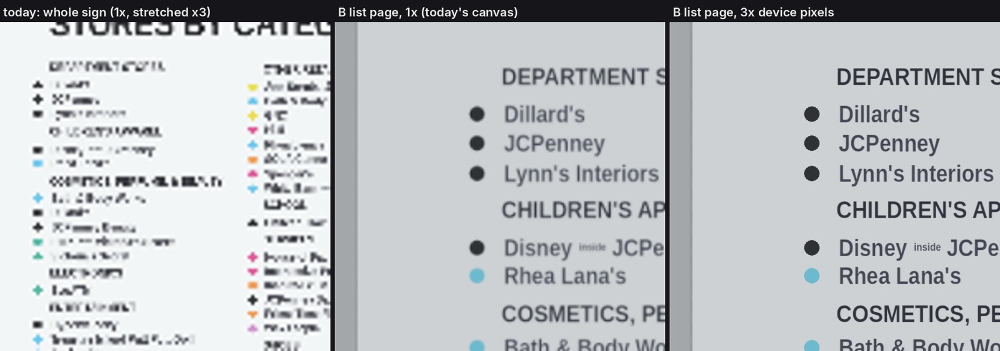

# Reading the directory kiosk: legibility options (Godot mall)

Workstream ws/directory, Nov 4 2026. **Prototypes for Steven to choose from; nothing here is the
final feature.** Follows `design/godot-directory.md` (the kiosk, the panels, today's reader) and
`design/godot-dialogue.md` (the camera that goes to a person you talk to).

**Steven's problem:** the store names on the kiosk are too pixelated to read. He would like the
camera to go to the kiosk the way it goes to a person you talk to, and text that reads by itself,
perhaps by zooming to the list or the map. Balance the real kiosk's look against legibility. Text
is moving off the game screen into the menu, so no new overlay text; text on the kiosk is fine.

## Why it is pixelated today (measured)
1. **The sign is shown whole, so the type is tiny.** The list type's capitals are about **14 panel
   px** tall (in `tex/dir/panel_*.png`, 2048 × 2290). Shown whole, the sign is drawn at 0.175 screen
   px per panel px on a 390-wide phone, which makes the capitals **2.4 px** tall. On a 1280 × 720
   desktop it is 0.28, so the capitals are **3.9 px**. No texture size can make that readable. You
   have to be closer, at about **0.7 px per panel px (capitals ~10 px)**.
2. **The game draws an iPhone at 390 × 844 pixels and Safari stretches that ×3.**
   `project.godot` has `window/dpi/allow_hidpi=false`, so every glyph is at most a third as sharp
   as the phone's screen. Even zoomed in, today's text is soft (see the crops below).
3. **Today's flat reader draws the 2048 px picture without mipmaps.** Godot's default canvas
   filter is plain linear, so drawing the picture at a sixth of its size skips pixels. That breaks
   the small type into the jagged marks in the left crop below, where it could have been a smooth
   grey blur. This is a one-line fix (`view.texture_filter = LINEAR_WITH_MIPMAPS`); option C uses it.

`directory-opt-legibility-iphone-crops.jpg`. All three crops are shown at the iPhone's physical
pixels:
- **Left:** today's reader, whole sign.
- **Middle:** option B's list page on today's canvas (1x, stretched by Safari).
- **Right:** the same page with the game drawing at device pixels (3x).

## The options (all behind a flag; off by default)
Turn on with **`?dirlook=a`**, **`b`** or **`c`** on the game URL (native: `-- --dirlook=b`).
Without the flag, the kiosk opens today's reader unchanged (checked).

**What all three share:**
- The camera leaves the player and glides to the kiosk in 0.6 s (cubic in-out, FOV 70 → 40°), as
  the talk camera does. The HUD hides as in a conversation. Closing glides back.
- **No new words on screen:** the only things drawn over the view are an **X** box and, in B, a
  **<** box.
- A and B select a store by lighting it on the sign itself: every list line and map block it has,
  tinted, with a pink outline (`HILITE #ff2d6f`, the colour today's reader uses), drawn by the
  sign's own shader. Tapping the lit store again jumps there.
- A and B draw the sign from a **4x panel** (`tex/dir/hi/panel_<year>.png`, 4096 × 4580, the same
  painter at `DIR_K=4`) on a quad 3 mm in front of the kiosk's panel. The quad exists only while
  you read, so the big picture is only in memory then.

### A: Face the sign (free zoom)
- **What it looks like:** the camera stops square on the whole lit panel in its aluminium frame.
  Pinch or the wheel dollies the camera in; drag pans across the sign. Tap a name or a block and it
  lights on the sign; tap it again to go.
  - Evidence: `directory-optA-<2026|1995>-<desktop|phone>-unbaked.jpg`.
- **Authenticity:** the highest. It is what standing at the kiosk is like: the real sign, nothing
  laid over it.
- **iPhone legibility:** the whole sign is unreadable (2.3 px capitals). Every visit needs a pinch
  to about 4x and a drag before anything reads. Once there, it reads like B (~10 px capitals; sharp
  only with device pixels, below).
- **Cost to finish:** about 0.5 day.
  - Dolly limits and inertia, gamepad zoom/pan, keyboard.
  - The year toggle and the confirm (see Open questions).
  - Update `dirtest.js`, a web check.

### B: List, then map (guided)
- **What it looks like:**
  - The camera frames the whole sign for half a second, then moves in to the store list at reading
    size (0.72 screen px per panel px, capitals ~10 px).
  - **Phone:** one column at a time, a screen tall. Swipe or the arrows turn the page.
  - **Desktop:** both list columns, the legend and the edge of the map on one page.
  - Tap a name: it lights (both lines for a store listed twice) and the camera glides across the
    sign to the store's block on the map, also lit, framed with its neighbours. A second tap goes;
    **<** or a tap off the stores goes back to the list.
  - Evidence: `directory-optB-<2026|1995>-<desktop|phone>-unbaked.jpg`, and
    `directory-optB-<2026|1995>-iphone3x-unbaked.jpg`.
- **Authenticity:** high. It is how you read the real kiosk: find the name, note its colour dot,
  look across to the block. Only the camera moves, and nothing is added except the lit outline.
- **iPhone legibility:** the best without any effort from the player. The list opens readable at
  ~10 CSS px capitals. With device pixels it is crisp (right crop).
  - **2026:** the real sign's map has **no store names on the blocks** (only the logo blocks), so on
    the map the name is the lit list line. On a desktop it is in the same view. On a phone you see
    the lit block, and the name stays on the page you picked it from.
  - **1995:** the 1994-style map has numbers on the blocks, and they read at the map framing.
- **Cost to finish:** about 1–1.5 days.
  - Page turning on every input (swipe, d-pad, stick, keys).
  - Picking on the map directly, landscape phones, a gamepad cursor.
  - The year toggle and the confirm, `dirtest.js`, a web check.

### C: Camera in, then the flat copy takes over
- **What it looks like:**
  - The camera glides to the kiosk as in A. On arrival, today's reader (`directory_ui.gd`) opens
    with its picture laid exactly over the 3D panel's place on screen. There is no dimming and no
    drawn frame (the real 3D frame is around it), so nothing visibly jumps.
  - From then on it is today's reader: wheel/pinch zoom, drag, tap, the hover name tag, the
    "Jump to this store?" box, the 1995/2026 time-travel toggle.
  - On a phone it opens already zoomed to the list at reading size. The mipmap fix is on.
  - Evidence: `directory-optC-<2026|1995>-<desktop|phone>-unbaked.jpg`, and
    `directory-optC-2026-iphone3x-unbaked.jpg`.
- **Authenticity:** medium.
  - The arrival is the 3D kiosk.
  - After that it is a flat picture with today's buttons, the name tag and the confirm box. Those
    are overlay text, which is what Steven is moving into the menu.
  - The flat copy is a little brighter than the lit 3D panel, so the handover shows as a slight
    brightening.
- **iPhone legibility:** as B on the list, since it opens at the same scale. It is the sharpest of
  the three with device pixels, because 2D is always drawn at full resolution there (see the lever
  below). Desktop opens on the whole sign (3.8 px capitals) and needs the wheel.
- **Cost to finish:** about 0.5 day. Almost everything exists and is tested. The work is the
  handover on window resize and the brightness match. It keeps today's overlay text unless that
  text moves to the menu.

### The sharpness lever (applies to A, B and C; Steven's call, global)
Draw the game at device pixels on phones:
- `allow_hidpi=true`.
- At start, `root.content_scale_factor = devicePixelRatio`, so the HUD keeps its size.
- `root.scaling_3d_scale = 1 / devicePixelRatio`, so the 3D world costs what it costs today.

While the camera is on the sign (A, B), `directory_look.gd _sharp()` raises the 3D scale to 1.0.
The view is then one unshaded quad, which is cheap even at 3x. C's flat copy is 2D and already
sharp.
- **Benefits:** every HUD and menu text on an iPhone gets 3x sharper too.
- **Risks:**
  - Global and untested on a real iPhone. The cloud cannot measure frame rate or Safari memory.
  - The 4x panel is ~100 MB of texture memory per year when uncompressed. ASTC would blur the type.
    3072 px is the fallback.
  - Some WebGL devices cap textures at 4096. The 4x panel is 4580 px tall, so the fallback would be
    needed there too.
  - Without the lever, the 4x panel buys nothing over 2048 on a phone (0.72 px per 2048-px is
    already downsampling). It matters only at device pixels or a big desktop window.
- Simulated natively with `--hidpi=3 --resolution 1170x2532`
  (`directory-opt*-iphone3x-unbaked.jpg`).

## Recommendation
**B, with the device-pixel lever.**
- It is the only option where the list is readable on an iPhone the moment you arrive, without a
  pinch.
- It keeps the kiosk itself as the only text on screen.
- It does what the real sign asks of you: find the name, look across to the block.

A is the purist version of the same look but makes every phone visit start with a pinch. A
reasonable hybrid is to finish B and let pinch/wheel also free-zoom as in A (about +0.25 day). C is
the cheapest and safest, but it brings back the flat overlay with text that is leaving the screen.
If the lever is turned down, B still reads (middle crop), only softer.

## How the map gets regenerated (layout changes, e.g. the C2 corner / Zales s33+s34)
None of the options bakes a picture of today's outline into code. All three read the painted panels
and their click areas, and those come from the layout files:
1. `godot --headless --path . --script res://tools/stores/directory/make_data.gd` writes `map.json`
   from `layout_mall.json` / `layout_2026.json` (`map_data.gd`).
2. `python3 tools/stores/directory/paint_dir.py` writes `tex/dir/panel_<year>.png` and
   `tex/dir/hotspots.json`.
3. **New:** `DIR_K=4 DIR_OUT=tex/dir/hi python3 tools/stores/directory/paint_dir.py`, then delete
   `tex/dir/hi/back.png` and `hotspots.json` there. This writes the 4x panels A and B use. The
   click areas stay the 2048 ones, scaled.
4. Rebuild the wings: their `gen/<wing>/directory.json` jump spots come from the layout too.

**What follows the layout:**
- **1995:** the plan is drawn from the game's map, so the moved court and the Orange Julius corner
  unit appear by themselves.
- **2026:** the coloured blocks are the **real sign's diagram, traced** (`paint_dir.py BLOCKS`). A
  layout change moves the stores' stretches on those blocks (`map_spot_2026`, from frontage order)
  and the click areas, not the block outlines. Zales on s33+s34 gets one stretch spanning both.

B's pages and map framings are computed at run time from the click areas (`_columns()`,
`_make_pages()`), so they follow a repainted list or map without changes.

## Files (branch ws/directory)
- **New:**
  - `scripts/directory_look.gd`: the three options, the lit-sign shader, the camera.
  - `tools/qa/dirlook_mini.gd`: the shots.
  - `tex/dir/hi/panel_1995.png`, `panel_2026.png` and their `.import` files (lossless + mipmaps,
    as the 2048 ones).
- **Changed (small, marked `PROTOTYPE ws/directory`):**
  - `scripts/directory_kiosk.gd`: `interact()` asks `directory_look.flag()` first; `_look()`.
  - `scripts/directory_ui.gd`: `look_rect` / `look_owner` for C. When set: no dimming and no drawn
    frame (`_draw_view` split into `_draw_frame` / `_draw_marks`, same drawing), the panel placed
    on `look_rect`, and `close()` hands back to the camera.
  - `tools/stores/directory/paint_dir.py`: `DIR_K` / `DIR_OUT` environment overrides; the defaults
    are unchanged.
- **Export:** `tex/dir/hi/*` should ride in the existing `tex/dir/*` include filter (not
  exported here: no build in this workstream).
- **No rebake:** the kiosk is dynamic and nothing baked changed.

## Checks
- `xvfb-run -a godot --path . --rendering-driver opengl3 --resolution 1280x720 --script
  res://tools/qa/dirlook_mini.gd -- --mode=b --year=2026 --out=/tmp/d/b26d` → `DIRLOOK SHOTS OK`.
  Run for each mode (a, b, c), year (1995, 2026) and size (1280 × 720, 390 × 844, and 1170 × 2532
  with `--hidpi=3`). `--mode=` (empty) opens today's reader: unchanged.
- **The shots are unbaked and outside the mall.** The kiosk stands alone in the preview room
  (`tools/qa/preview.gd`) with a stand-in player. On the shared cloud box, loading a whole wing was
  OOM-killed every time (seven tries) (other sessions' imports and Blender jobs). Everything after the
  approach frame is the sign filling the view, so the hall does not change what the shots show.
  Not run: a web export.

## Open questions for Steven
1. **Which option** (A, B, C, or B with A's free zoom)? And the **device-pixel lever**, yes or no?
2. **The 1995 / 2026 time-travel toggle** lives on today's reader (MENU2: the only way to change
   year). A and B leave it out. Where should it go: the menu, or something on the kiosk itself
   (such as a lit button on the frame)?
3. **"Jump to this store?"** A and B use "tap the lit store again to go", with no question box.
   Is that enough, or should the confirm move into the menu?
4. **The lit outline** on the sign (pink, as today's reader) is not on the real kiosk. Is it
   acceptable, or should the camera framing alone carry the selection?
5. **2026 map has no names on blocks** (as on the real sign). On a phone, B's map view shows the
   lit block but not its name. Is that OK, or should the camera pull back far enough to keep the
   lit list line in view?
