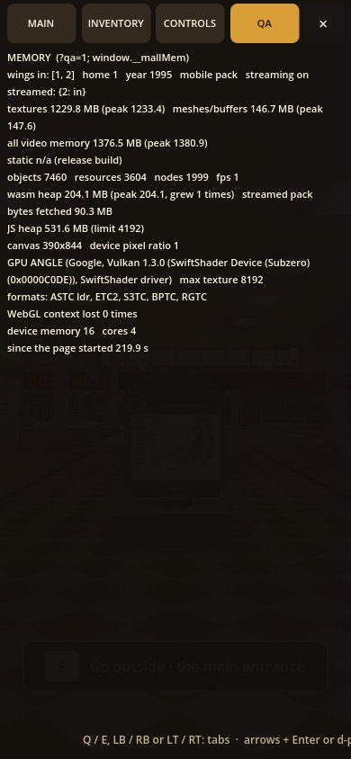

# PHONE-MEMORY, stage 1: where a phone's memory goes (Mon Nov 16, 2026)

Branch `ws/phone-memory` from `ws/seamless-upfront` (`74cef19e`). Stage 1 of the brief: measure, change no
behaviour. The one code change is a memory readout behind `?qa=1` (section c). Not baked, not published, nothing
uploaded.

**Nothing here was run on an iPhone.** Sources: the mobile packs of the last R2 build (`20261114-1715-5ba126d8`,
the int-55 preview Steven's iPhone crashed on; this branch changes no texture), Godot 4.7.2's own source for what
the web renderer does with each format, a native Linux run with a real GL renderer (Mesa llvmpipe) for the engine's
own memory counters, and headless Chromium (swiftshader) for the wasm heap and the page's memory.

> **Nov 17, Steven's iPhone** (preview `20261117-0522-6ba34fcc`): both `?qa=1` (streaming off, one wing) and
> `?qa=1&stream=1` crashed ("A problem repeatedly occurred"), the first after hanging on the load screen. One wing
> does not fit on this phone with this build either. No readout numbers: the game never ran far enough. Details and
> the next checks: `production/session-handoff-2026-11-16-PHONE-MEMORY.md`.

## Summary

1. **The mobile lightmaps are 8 times their size in memory on the web.** They ship as ASTC 4x4 **HDR**. Godot's web
   renderer never treats ASTC HDR as supported (it looks for the GL extension name
   `GL_KHR_texture_compression_astc_hdr`, which WebGL never lists: in WebGL, HDR is a "profile" of
   `WEBGL_compressed_texture_astc`). So each lightmap is decompressed on the CPU (astcenc, in the wasm heap) to
   half-float RGBA, 8 bytes a pixel, and uploaded uncompressed. Wing 1 1990s: 12.6 MB on disk, **100.7 MB** in GPU
   memory, plus 12.6 + 100.7 MB of CPU copies in the wasm heap while it is decompressed. A second mall wing adds the
   same again. Computers do not pay this (BC6H is used compressed). This is new: no earlier note mentions it.
2. **Most textures are lossless WebP, uncompressed in memory:** 702 RGB8 files over all mobile packs, 236 MB on
   disk, about 3 GB if every one were loaded. Measured in the engine: see section b.
3. **The page keeps every streamed pack twice.** `web/shell.html` keeps the fetched pack's bytes in
   `window.__mallPre[url]` (a promise that holds the whole ArrayBuffer for the rest of the visit) and
   `engine.copyToFS` copies them into the engine's file system (`FS.writeFile`, a second copy). While the download
   is assembled there is a third (the chunks and the joined array). For wing 2 that is 2 x 94.5 MB held, 3 x briefly.
4. **The wasm heap only grows.** The engine's heap starts at 32 MB and grows in steps of up to 20 % (or 96 MB) to at
   most 2 GB. On iOS growing it can mean finding one new block of the new size and copying the old one, with both
   held for a moment; a heap is never given back.
5. Whether the crash is memory at all is not proven. Section d lists what else happens on the phone 4 s in, and how
   to tell from the readout and from Safari's Web Inspector.
6. **Measured (section b): one 1990s wing is about 0.9 GB of textures on the phone pack, two are about 1.4 GB.**
   In the browser with the phone pack: one wing 812 MB of textures, 898 MB of video memory, a 142 MB wasm heap and
   251 MB of JavaScript heap; with wing 2 streamed in, 1,229 MB of textures, 1,335 MB of video memory, a 204 MB wasm
   heap and 529 MB of JavaScript heap. **About +0.6 GB on top of about 1.3 GB.** 2026 is about half (one wing 453 MB
   of textures, two 803 MB). The department stores are cheap (30 to 40 MB each). The cost is the second mall wing.
7. What uses one 1990s wing's textures (priced at phone cost): surface pictures 197 MB, Blender items 130 MB (one
   item is up to 50 MB: three 2048 maps), the lightmap 96 MB, the cast 93 MB, normal maps 65 MB; about 300 MB more
   is engine-side (shadow map, font caches, cubemaps, render targets) and not itemised.

## a. Textures and lightmaps per mobile pack (R2 build `20261114-1715-5ba126d8`)

`tools/qa/packmemory.py <packs> --files` (new) lists every texture with format, size, mips, bytes on disk and bytes
in GPU memory on the web. The full per-file list for every pack is
`production/qa/evidence/wsPHONE-MEMORY-textures.md`. GPU bytes follow Godot 4.7.2's
`drivers/gles3/storage/texture_storage.cpp`: WebP / PNG are decoded and uploaded uncompressed (RGB8 counted as 4
bytes a pixel, as Apple GPUs store it), ETC2 and ASTC LDR stay compressed, ASTC HDR is decompressed to RGBAH (8
bytes a pixel), mip chains counted whole.

"If all loaded" is an upper bound: it counts every texture inside the pack, and a pack carries files a wing only loads
on demand (the directory's 4096 x 4580 close-up panels, 100 MB each in memory, only when the directory is opened; the
items' 2048 pictures only when the item is made). What a wing really loads is measured in section b.

| Pack | MB | Textures | MB on disk | MB in GPU (all loaded) | albedo | normal | lightmap | stand-in | ui | cast | cast normal | items 3D |
|---|---|---|---|---|---|---|---|---|---|---|---|---|
| w1 | 90.9 | 325 | 63.5 | 653.6 | 263.9 | 0.0 | 100.7 | 12.8 | 263.8 | 12.5 | 0.0 | 0.0 |
| w2 | 94.5 | 438 | 60.1 | 702.3 | 316.1 | 0.0 | 100.7 | 9.3 | 263.8 | 12.5 | 0.0 | 0.0 |
| w4 | 38.9 | 171 | 30.6 | 383.6 | 72.8 | 0.0 | 25.2 | 11.2 | 263.8 | 10.6 | 0.0 | 0.0 |
| w5 | 39.8 | 172 | 30.3 | 380.2 | 77.8 | 0.0 | 16.8 | 11.2 | 263.8 | 10.6 | 0.0 | 0.0 |
| w6 | 20.6 | 154 | 14.5 | 340.3 | 65.9 | 0.0 | 0.0 | 0.0 | 263.8 | 10.6 | 0.0 | 0.0 |
| w1y26 | 48.2 | 172 | 35.2 | 410.8 | 28.5 | 0.0 | 67.1 | 40.8 | 263.8 | 10.6 | 0.0 | 0.0 |
| w2y26 | 79.2 | 287 | 53.5 | 642.7 | 263.9 | 0.0 | 67.1 | 37.3 | 263.8 | 10.6 | 0.0 | 0.0 |
| w4y26 | 92.3 | 232 | 75.9 | 997.5 | 446.0 | 184.5 | 25.2 | 67.4 | 263.8 | 10.6 | 0.0 | 0.0 |
| w5y26 | 35.0 | 173 | 25.1 | 440.3 | 81.7 | 0.0 | 16.8 | 67.4 | 263.8 | 10.6 | 0.0 | 0.0 |
| w6y26 | 20.8 | 154 | 14.5 | 340.3 | 65.9 | 0.0 | 0.0 | 0.0 | 263.8 | 10.6 | 0.0 | 0.0 |
| common | 59.6 | 24 | 47.2 | 218.1 | 0.0 | 0.0 | 0.0 | 0.0 | 0.0 | 162.2 | 55.9 | 0.0 |
| items | 83.9 | 301 | 74.8 | 1315.0 | 0.0 | 428.9 | 0.0 | 0.0 | 5.1 | 0.0 | 0.0 | 881.1 |

Kinds: *albedo* = surface pictures (walls, floors, fronts, signs, stock); *normal* = normal maps (mostly the Lynn's
2026 and Blender items' 2048 normal maps); *lightmap* = the baked light (one layered texture per wing); *stand-in* =
the pictures of the other wing across the seam and of the room wings' openings; *ui* = item icons, the directory
panels, the dialogue add-on's pictures, fonts; *cast* = the cast's heads and bodies and shopper skins; *items 3D* =
the Blender items' albedo and ORM maps. *Probes*: no reflection-probe or light-probe texture ships in a pack. The
LightmapGI's light probes are a few kilobytes inside the `.lmbake`; the reflection probes (room wings) render into
the engine's probe atlas at run time (in "video memory", section b).

| Stored as (all packs, counted once by source path) | Files | MB on disk | MB in GPU |
|---|---|---|---|
| webp-lossless RGB8 | 702 | 235.8 | 2955.9 |
| VRAM ASTC_4x4_HDR | 8 | 52.4 | 419.4 |
| webp-lossy RGB8 | 118 | 4.6 | 159.5 |
| webp-lossless RGBA8 | 225 | 7.9 | 80.5 |
| VRAM ETC2_RGB8 | 42 | 27.1 | 27.1 |
| webp-lossy RGBA8 | 15 | 0.3 | 9.1 |
| VRAM ETC2_RGBA8 | 22 | 7.1 | 7.1 |

Mips: of 2,023 lossless texture files in the mobile packs (a file in two packs counted twice), 64 have mipmaps (the cast's heads and bodies, the directory panels). The rest have
none, so mips are not where the memory goes.

### Two wings, upper bounds (every texture of the packs counted once by source path)
A texture both packs carry is loaded once: the second pack is mounted with `replace_files = false` and the same
`res://` path finds the one already in the engine's cache.

| Wings in (+ common + items) | Pack bytes | Textures, counted once | GPU MB if all loaded | of which lightmaps (RGBAH) |
|---|---|---|---|---|
| w1 | 234 MB | 650 | 2187 | 101 |
| w2 | 238 MB | 763 | 2235 | 101 |
| w1 + w2 | 329 MB | 911 | 2572 | 201 |
| w1 + w4 | 273 MB | 657 | 2223 | 126 |
| w2 + w5 | 278 MB | 787 | 2326 | 117 |
| w1 + w2 + w4 + w5 | 408 MB | 921 | 2624 | 243 |
| w1y26 | 192 MB | 497 | 1944 | 67 |
| w2y26 | 223 MB | 612 | 2176 | 67 |
| w1y26 + w2y26 | 271 MB | 634 | 2296 | 134 |
| w1y26 + w4y26 | 284 MB | 583 | 2627 | 92 |
| w2y26 + w5y26 | 258 MB | 636 | 2298 | 84 |
| w1y26 + w2y26 + w4y26 + w5y26 | 398 MB | 723 | 2970 | 176 |

### Lightmaps

| Pack | Size x layers | On disk MB | Web GPU MB (RGBAH) | Desktop GPU MB (BC6H) |
|---|---|---|---|---|
| w1 | 2048x2048 x 3 | 12.6 | 100.7 | 12.6 |
| w2 | 2048x2048 x 3 | 12.6 | 100.7 | 12.6 |
| w4 | 1024x1024 x 3 | 3.1 | 25.2 | 3.1 |
| w5 | 1024x1024 x 2 | 2.1 | 16.8 | 2.1 |
| w1y26 | 2048x2048 x 2 | 8.4 | 67.1 | 8.4 |
| w2y26 | 2048x2048 x 2 | 8.4 | 67.1 | 8.4 |
| w4y26 | 1024x1024 x 3 | 3.1 | 25.2 | 3.1 |
| w5y26 | 1024x1024 x 2 | 2.1 | 16.8 | 2.1 |

## b. Where one wing's memory goes, then two

### Measured natively: the engine's own counters, one wing then two (`tools/qa/mem_native.gd`)
Linux editor binary, Mesa llvmpipe (a real GL renderer, so textures are really uploaded and counted), the phone
path of the streamer (`kind` mobile), the player at the wing's spawn, 300 frames to settle before each sample.
MB here are 2^20 bytes. On a Linux GL the engine uploads the desktop copies of VRAM textures (S3TC = the same bytes
as ETC2; BPTC lightmap = 1/8 of the web's RGBAH); the "phone-pack" column adds the lightmaps' difference, from the
inventory. **Everything else is the same picture data a phone uploads**, but a phone's driver may pad or keep copies
this cannot see: read these as a floor.

| Year | Wings in | Engine: textures MB (Linux GL) | Phone-pack textures MB (lightmaps as RGBAH) | Mesh buffers MB | All video MB (phone pack) | Engine heap (static) MB | Objects / resources / nodes |
|---|---|---|---|---|---|---|---|
| 1990s | wing 1 | 830 | **914** | 44 | 958 | 117 | 4667 / 1745 / 1066 |
| 1990s | wing 1 + wing 2 (the seam) | 1249 | **1417** | 75 | 1492 | 140 | 7470 / 3537 / 1981 |
| 2026 | wing 1 | 406 | **462** | 22 | 484 | 82 | 2850 / 630 / 517 |
| 2026 | wing 1 + wing 2 (the seam) | 757 | **869** | 43 | 912 | 100 | 4557 / 1699 / 1083 |
| 1990s | wing 2 | 858 | **942** | 55 | 996 | 152 | 6174 / 2320 / 1331 |
| 1990s | wing 2 + Dillard's (5) | 876 | **974** | 107 | 1081 | 160 | 6932 / 2623 / 1789 |
| 1990s | wing 1 | 830 | **914** | 46 | 960 | 118 | 4667 / 1745 / 1066 |
| 1990s | wing 1 + Sears (4) | 848 | **954** | 48 | 1001 | 124 | 5439 / 2050 / 1536 |

Textures in the scene tree, priced at phone-pack cost (MB, `tools/qa/packmemory.py` inventory):

| Year | Wings in | Textures | Sum | albedo | normal | lightmap | cast | cast normal | items 3D | ui | stand-in |
|---|---|---|---|---|---|---|---|---|---|---|---|
| 1990s | wing 1 | 251 | 618 | 197 | 65 | 96 | 72 | 21 | 130 | 24 | 12 |
| 1990s | wing 1 + wing 2 (the seam) | 533 | 1107 | 460 | 105 | 192 | 74 | 21 | 210 | 24 | 21 |
| 2026 | wing 1 | 45 | 164 | 23 | 4 | 64 | 2 | 0 | 8 | 24 | 39 |
| 2026 | wing 1 + wing 2 (the seam) | 200 | 560 | 259 | 24 | 128 | 3 | 0 | 48 | 24 | 74 |
| 1990s | wing 2 | 397 | 606 | 297 | 56 | 96 | 11 | 0 | 112 | 25 | 9 |
| 1990s | wing 2 + Dillard's (5) | 404 | 635 | 304 | 56 | 112 | 11 | 0 | 112 | 25 | 14 |
| 1990s | wing 1 | 251 | 618 | 197 | 65 | 96 | 72 | 21 | 130 | 24 | 12 |
| 1990s | wing 1 + Sears (4) | 257 | 653 | 203 | 65 | 120 | 72 | 21 | 130 | 24 | 17 |

**Where one wing's memory goes (1990s wing 1, phone pack, estimated where marked):**

| | MB | How known |
|---|---|---|
| Textures the scene uses: surface pictures 197, Blender items 130 (the RadioShack RC box alone is three 2048 maps, 50 MB), lightmap 96, the cast 93 (two 2048 heads with mips, 21 MB each), normal maps 65, the directory panel 24, stand-ins 12 | 618 | measured (the tree) and priced from the pack |
| Other texture memory the engine counts: the directional shadow map (Godot's default 4096, about 64 MB), the signs' font glyph caches, the sky and probe cubemaps, render targets, pictures scripts hold outside the tree | about 296 | measured as the difference; the split is estimated |
| Mesh buffers (vertices, indices) | 44 | measured |
| Engine heap: scenes, meshes' CPU copies, collision, scripts, the crowd (debug build's count; a release build is a little smaller) | 117 (peak 147) | measured natively |
| Pack bytes held by the page: wing 1 91 + items 84 + common 60 | 235 | file sizes (section d: streamed packs twice) |
| The page's drawing buffers on an iPhone: 1179 x 2556 colour + depth, Safari's composited copy | about 25 to 40 | estimated (3D is drawn at 1/3 scale, scripts/hidpi.gd) |
| wasm heap (holds the engine heap above plus decode buffers; it never shrinks) | 142 (2026: 124) | measured in Chromium, below |
| Audio | small: no music; short sound effects | not measured |

**With two wings:** the seam (1990s) adds 503 MB of textures on the phone pack (419 measured + 84 for the second
lightmap), 31 MB of mesh buffers, 23 MB of engine heap, and 2 x 94.5 MB of pack bytes in the page (section d).
**About 1.4 GB of textures for wings 1 and 2 of the 1990s**, against about 0.9 GB for one. In 2026 the mall wings
are about half that (0.46 GB one, 0.87 GB two). A department store is cheap: Dillard's adds 32 MB of textures and
52 MB of mesh buffers to wing 2; Sears 40 MB of textures to wing 1. **The cost is the second mall wing, in 1990s
most of all.**

**Why the 1990s phone works with one wing and dies with two (a judgement):** Safari on an iPhone allows a tab about
1 to 1.5 GB in all (`design/godot-build-hosting.md`; it depends on the model and on what else is open). One 1990s
wing is already about 0.9 GB of textures + 0.3 GB of page and heap; two are about 1.4 GB of textures + 0.6 GB.
That fits "runs with one, crashes within seconds of the second", but it is not proven; section d says how to prove it.

### Measured in the browser (headless Chromium, swiftshader, phone pack, `?qa=1`; `tools/qa/mem_webtest.py`)
The page's own address plus `?pack=mobile&qa=1&stream=0|1`, a 390 x 844 window, 120 s of sampling after the load
screen lifts (streaming off) or after wing 2 is in (streaming on). Read from `window.__mallMem`. Swiftshader keeps
textures in ordinary memory, so "all Chromium processes" is far above a phone's; **the engine's counters and the wasm
heap are the same numbers a phone would report** (swiftshader offers ASTC LDR and ETC2 like an iPhone; the lightmaps
are decompressed as on an iPhone).

| Year | Streaming | Wings in | Textures MB | Mesh buffers MB | All video MB (peak) | wasm heap MB (grew) | JS heap MB | Streamed pack bytes fetched MB | All Chromium processes, peak MB |
|---|---|---|---|---|---|---|---|---|---|
| 1990s | off | 1 | 812 | 86 | 898 (931 with the menu open) | 142 (0) | 251 | 0 | 4,064 |
| 1990s | on | 1, then 1 + 2 | **1,229** | 106 (147 with the menu open) | **1,335** (1,381) | **204** (1, while wing 2 loaded) | 529 | 90.3 | 4,987 |
| 2026 | off | 1 | 453 | 73 | 526 | 124 (0) | 201 | 0 | 3,319 |
| 2026 | on | 1, then 1 + 2 | **803** | 72 | **875** | **149** (1, while wing 2 loaded) | 361 | 75.7 | 4,101 |

**What the streaming-on run did (the readout's events, 1990s):** page start at 5.3 s (when the engine's scripts
start); wing 2 `load` at 28.9 s (its pack had already arrived: the fetch took under a second here); the load screen
lifted at 30 s; wing 2 `in` at 67.4 s, and the wasm heap had grown from 141.7 to 204.1 MB meanwhile (one growth). On a
phone the same happens 4 s after the engine starts, while the player can already see the mall.

**One wing to two, on the phone pack (1990s):** textures +417 MB, all video memory +437 MB, wasm heap +62 MB
(never given back), page memory +90 MB of pack bytes twice (section d) and the fetch's transient copies. **About
+0.6 GB in all, on top of about 1.3 GB.** The browser measurement agrees with the native one (one wing 0.9 GB of
textures on the phone pack, two 1.4 GB; the browser shows slightly less, 0.81 and 1.23, probably because a few things
were not yet made 120 s in).

## c. The readout (`?qa=1`)

**Open the game with `?qa=1`** (it works with the other switches: `?qa=1&stream=1` turns phone streaming on), open the
menu, step to the last tab, **QA**. Nothing is added to the game screen. The tab exists only while the sampler does
(`scripts/mall_mem.gd`, made by the streamer only with `?qa=1`), and it reads once a second while open.

| Line | What it is | Where it comes from |
|---|---|---|
| wings in, home, year, pack, streaming | the wings whose scene is in; the wing whose systems are running; the year; `desktop` / `mobile`; streaming on / off | the streamer (`scripts/wing_stream.gd`) |
| streamed | each streamed wing's state: `fetch`, `load`, `enter`, `settle`, `in` | the streamer |
| textures, meshes/buffers, all video memory (and peaks) | what the engine has uploaded to the GPU | `Performance.RENDER_TEXTURE_MEM_USED`, `RENDER_BUFFER_MEM_USED`, `RENDER_VIDEO_MEM_USED` |
| static | the engine's heap count: **n/a in a release export** (the engine counts it only in debug builds); the wasm heap below stands in for it | `Performance.MEMORY_STATIC` |
| objects, resources, nodes, fps | | `Performance` |
| wasm heap (peak, times grown) | the engine's whole memory block; it only grows | `engine.rtenv.HEAP8.buffer.byteLength` |
| streamed pack bytes fetched | the streamed packs' bytes the page fetched (each is held twice: section d) | `window.__mallStreamBytes` |
| JS heap | Chrome only ("not told" on Safari) | `performance.memory` |
| canvas, device pixel ratio | the drawing buffer's size | the canvas |
| GPU, max texture, formats | the GPU's name, `ASTC ldr(+hdr)`, `ETC2`, `S3TC`, `BPTC`, `RGTC` | WebGL extensions; `getSupportedProfiles()` |
| WebGL context lost | GPU process trouble | `webglcontextlost` |
| device memory, cores | Chrome only for memory | `navigator` |
| LAST VISIT | after a reload: whether the last visit ended normally, its last sample and its last 40 events (wing states, heap growth, context loss, page left) | localStorage `mall-mem-last` |

**For scripts:** `window.__mallMem` is the same as one object (`tex_mb`, `buf_mb`, `video_mb`, `wings`, `states`,
`wasm_mb`, `wasm_peak_mb`, `wasm_grew`, `packs_mb`, `canvas`, `dpr`, `gpu`, `formats`, `lost`, `peak`, `last`,
`events` …). `tools/qa/mem_webtest.py` reads it.

**What Steven reads off his iPhone** (once the director has put this branch's export on R2):
1. `…/index.html?qa=1` (streaming off, one wing): open the menu, QA. Note textures, all video memory, wasm heap,
   formats, GPU. Walk around for a minute; note the peaks.
2. `…/index.html?qa=1&stream=1` (the phone streaming that crashed). If it crashes, Safari reloads the page (it keeps
   `?qa=1`): open the menu, QA, read LAST VISIT. A screenshot of the tab is enough.
3. The same on the iPad: the "pack" and "formats" lines say whether it takes the desktop or the mobile path.
4. If a Mac is at hand: Web Inspector's Timelines > Memory during step 2, and the `JetsamEvent` file afterwards
   (section d).

**Cost when on:** one JSON round-trip to the page a second and one localStorage write a second. Off (no `?qa=1`):
nothing is made; the menu has its usual three tabs.

## d. Is it memory?

With streaming on (`?stream=1`, phone pack) the phone does five things in the first seconds that it does not do with
streaming off. Any of them could be the crash; the first four are memory.

| What happens about 4 s in (spawn at (33, 0), 2 m from the seam; `start_delay_s` 4, `near_m` 60) | Memory it takes (wing 2, 1990s) | Where |
|---|---|---|
| 1. Wing 2's pack (94.5 MB) is downloaded: the chunks, then one joined copy | 94.5 MB held, about 190 MB for a moment while the chunks are joined | page (JavaScript) |
| 2. A clone of the response goes to Cache Storage | the clone's body is read alongside: up to another 94.5 MB until stored | page / network process |
| 3. `engine.copyToFS` writes it into the engine's file system (`FS.writeFile` copies) and `window.__mallPre` keeps the fetched buffer for good | **2 x 94.5 MB held for the rest of the visit** | page (JavaScript) |
| 4. Wing 2's resources load: meshes, WebP pictures decoded, the lightmap decompressed (astcenc) | the wasm heap grows; the lightmap alone needs 12.6 MB + 100.7 MB of CPU copies while it is decompressed | wasm heap (only grows) |
| 5. Wing 2's meshes and textures go to the GPU and are drawn; its materials' shaders compile | textures + 100.7 MB lightmap; see section b | Safari's GPU process |

**How a memory kill looks on an iPhone:** the page goes white and reloads by itself, then shows "A problem repeatedly
occurred" if it happens again. That is the WebContent process being killed by iOS (jetsam) for going over its limit.
If only the GPU process is in trouble, WebGL loses its context: the picture freezes or goes black and the page does
**not** reload.

**How to tell from the readout (`?qa=1`, menu, QA tab), after Safari reloads the page:**
- "LAST VISIT: did NOT end normally" and its last sample and events (the readout writes them once a second and at
  every wing state change, wasm heap growth and context loss). The wing's last state says where it died:
  `fetch` (downloading or copying the pack: page memory, 1 to 3), `load` (resources and the lightmap: wasm heap, 4),
  `enter` / `settle` / `in` (GPU upload and the first draws, 5).
- "wasm heap grew to N MB" events just before the end point at 4; "WebGL context LOST" points at the GPU (5).
- "left normally" with the page reloading anyway: not a crash of this page (a navigation).
- The last sample is up to a second old; a crash inside one long frame (a lightmap decompress is one call) shows the
  state just before it.

**How to tell from Safari's Web Inspector** (iPhone: Settings > Apps > Safari > Advanced > Web Inspector on; cable to
a Mac; Mac Safari > Develop > the iPhone > the page):
- Timelines > Memory (record before the 4 s mark): JavaScript, Images, Layers, Page. A climb in "JavaScript" at the
  fetch is 1 to 3; in "Page" (which holds the wasm heap) at load is 4. The inspector disconnects when the process dies:
  the last point before that is the answer.
- Console: `WebGL: context lost` (5), `RangeError: Out of memory` or `Maximum call stack` (a failed heap growth or
  allocation: 4), the engine's own `Image format ASTC_4x4_HDR not supported by hardware, converting to RGBAH` warning
  (one per lightmap: confirms section a's point 1 on the phone).
- After the crash, on the iPhone: Settings > Privacy & Security > Analytics & Improvements > Analytics Data. A file
  `JetsamEvent-<date>.ips` at the time of the crash names the process iOS killed (`com.apple.WebKit.WebContent` = the
  page; `com.apple.WebKit.GPU` = the GPU process) and the reason (`per-process-limit`). That is proof it was memory.
  No such file at that time: look elsewhere (a WebKit or engine crash shows as a `WebKit.WebContent-<date>.ips` crash
  log instead).

**Other differences, not memory:** the streamer's per-frame loading (6 ms a frame), the crowd being remade for two
wings, two wings' meshes drawn at once (more draw calls), and shader compiles for the second wing's materials. These
cost time, not much memory; a phone stuttering is likely, a phone dying of them is not.

## e. What iPhone and iPad Safari support, and what Godot's web export does with it

**What the browsers offer** (WebGL 2, which the game needs, is in Safari since iOS 15):

| | iPhone (A-series GPU) | iPad with an A-series chip | iPad with an M-series chip | Mac Safari (for comparison) |
|---|---|---|---|---|
| ETC2 / EAC (`WEBGL_compressed_texture_etc`) | yes (native) | yes | yes | yes on Apple silicon |
| ASTC (`WEBGL_compressed_texture_astc`), LDR profile | yes (A8 and later) | yes | yes | yes on Apple silicon |
| ASTC HDR profile | the GPU has it from A13; whether WebKit lists `"hdr"` is not known. **Does not matter for Godot** (below) | same | same | same |
| S3TC (BC1-3) and BPTC (BC6H, BC7) | no | no | **not known**: Metal has BC formats on M-series iPads; whether Safari exposes them there is what the readout's "formats" line will say | yes on Apple silicon |

These are from public WebKit and Metal documentation as I know it, not checked on a device. The readout prints the
real list (GPU name, formats with ASTC profiles, max texture size), so one look at Steven's iPhone and iPad settles it.

**What the page and Godot do with them:**
- `web/shell.html` picks the pack: `?pack=`, then a remembered choice, then **desktop if the browser has S3TC + BPTC**,
  else mobile if it has ETC2 + ASTC, else the user agent. The streamer's "kind" (`data/stream.json` desktop / mobile)
  is that same choice. **So an iPad that exposes S3TC + BPTC gets the desktop pack and the desktop streaming path:
  every interior wing up front, four wings in memory.** If the readout on an M-series iPad says "desktop", that iPad
  has the computer's behaviour today, not the phone's (and it has not crashed in anyone's report yet). A question for
  Steven: which iPad does he have?
- Godot exports VRAM-compressed textures twice: S3TC (DXT1/DXT5) and BPTC for "desktop", ETC2 (RGB8/RGBA8) and
  ASTC 4x4 for "mobile" (`export_presets.cfg` `vram_texture_compression/for_desktop|for_mobile`,
  `project.godot` `import_etc2_astc=true`). Lossless and lossy textures are WebP and are the same file in both packs.
- In the browser (`drivers/gles3/storage/config.cpp`, web build): `etc2_supported` is always true; `astc_supported`
  is true with `WEBGL_compressed_texture_astc`; **`astc_hdr_supported` is always false** (it needs the GL name
  `GL_KHR_texture_compression_astc_hdr`, which WebGL does not report; HDR is a profile, not an extension). A format the
  device lacks is decompressed on the CPU and uploaded uncompressed, with a warning in the console
  (`texture_storage.cpp` `_get_gl_image_and_format`).
- The mobile lightmaps are imported with `compress/mode=2` (VRAM) and `compress/hdr_compression=1`, which gives
  `ASTC_4x4_HDR` for mobile and `BPTC_RGBFU` (BC6H) for desktop. BC6H is used as is on a computer; **ASTC HDR is always
  decompressed on the web, to RGBAH (8 bytes a pixel)**. Every mobile device pays it: iPhone, iPad, Android, Quest.
- Basis Universal (`compress/mode=4`) exists too: one file for both kinds, transcoded at load to ASTC / ETC2 / BC as
  the device has. It would change the desktop textures as well; noted for stage 2, not proposed.

## Tests

- **The 8 headless suites**, baseline on `74cef19e` (unchanged, run first): SHOP 200, CUCOS 89, FLAGS 31, INVENTORY 45,
  REDEMPTION 32, ECON 52, MENU UNIT 64, INT D49: all OK. **On this branch** (the readout added): the same, all OK.
  (Both runs before the lightmaps were unpacked into the project; the suites test logic, not light.)
- `tools/qa/mem_native.gd`: MEM NATIVE OK for the seam 1990s and 2026, wing 2 + Dillard's, wing 1 + Sears.
- `tools/qa/mem_webtest.py`: MEM WEB OK, 1990s and 2026, streaming off and on, 0 page errors; the QA tab photographed.
- Export `/home/claude/build57` (wings 1, 2, 4, 5, both years, both kinds, and the shared packs): `packcontents`
  every reference shipped. Pack sizes within 15 KB of R2 `20261114-1715-5ba126d8`'s (this branch's scripts, `scripts/mall_mem.gd` among them,
  and the menu change ship in every pack).
- **Not rerun in stage 1 (no behaviour changed; the readout is made only with `?qa=1`):**
  `stream_natural_walk_webtest.py` (desktop packs), packtest, seamtest. They are stage 3's.
- Evidence: `wsPHONE-MEMORY-qa-tab-one-wing-1990s-unbaked.jpg` (streaming off; taken before the whole-number fix,
  so it reads "1995.0"), `wsPHONE-MEMORY-qa-tab-two-wings-1990s-unbaked.jpg` (streaming on, wing 2 in),
  `wsPHONE-MEMORY-textures.md` (every texture).

## For the director (the phone preview)
- Export this branch (`tools/export_web.sh`; nothing in export or publish changes) and put it on R2 as a preview.
  Phones still have streaming off by default; Steven turns it on with `?stream=1`.
- Steven's steps are in section c ("What Steven reads off his iPhone"). The numbers wanted back: one wing's textures,
  all video memory and wasm heap (`?qa=1`); with `?qa=1&stream=1` whether it crashes and, if so, the LAST VISIT block;
  the iPad's pack and formats lines; a `JetsamEvent` file if there is one.
- No rebake: nothing in a scene, mesh, lightmap or texture changed. The stand-ins are not stale.
- Shared files touched (small, separate hunks): `scripts/wing_stream.gd` (`_init`: make `MallMem` with `?qa=1`),
  `scripts/menu/menu.gd` (a QA tab only while `MallMem` exists). New: `scripts/mall_mem.gd`, `tools/qa/packmemory.py`,
  `tools/qa/mem_native.gd`, `tools/qa/mem_webtest.py`.
- `CLAUDE-CLOUD.md` setup step 3 fails when run from the project folder (`git archive` takes the path relative to
  the current folder): run it from the repository root, `git archive origin/godot-build lightmaps standin | tar -x -C
  prototypes/godot-mall/project`, then the moves. I did not change that file (not in this job's scope).

## What stage 2 will compare (not decided; for the record of what the numbers point at)
- The mobile lightmaps: today 8 bytes a pixel on every phone. Candidates: an LDR or RGBE9995 (4 bytes a pixel, a
  core WebGL 2 format) lightmap for the mobile pack only, or a half-size mobile lightmap made from the same bake (no
  rebake). Each changes the phone's picture of the light: shots needed.
- The lossless WebP surface pictures as ETC2 / ASTC on the mobile pack only (desktop byte-for-byte unchanged), with
  signs and lettering kept lossless; the Blender items' and cast's 2048 maps at a smaller size on phones.
- Holding a streamed pack once instead of twice (`window.__mallPre`), and dropping it after mount: page memory only,
  no picture change.
- One mall wing at a time on phones, with the department stores streamed (they are cheap: 30 to 40 MB each).

